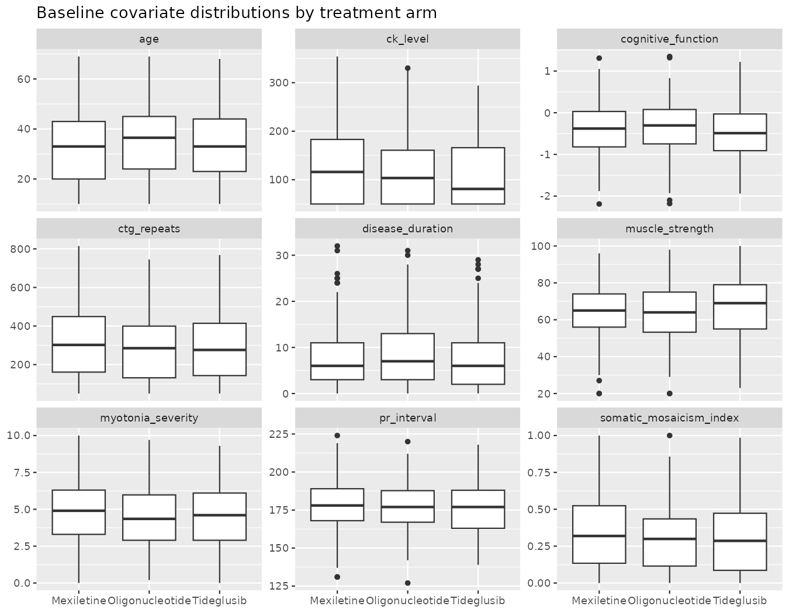
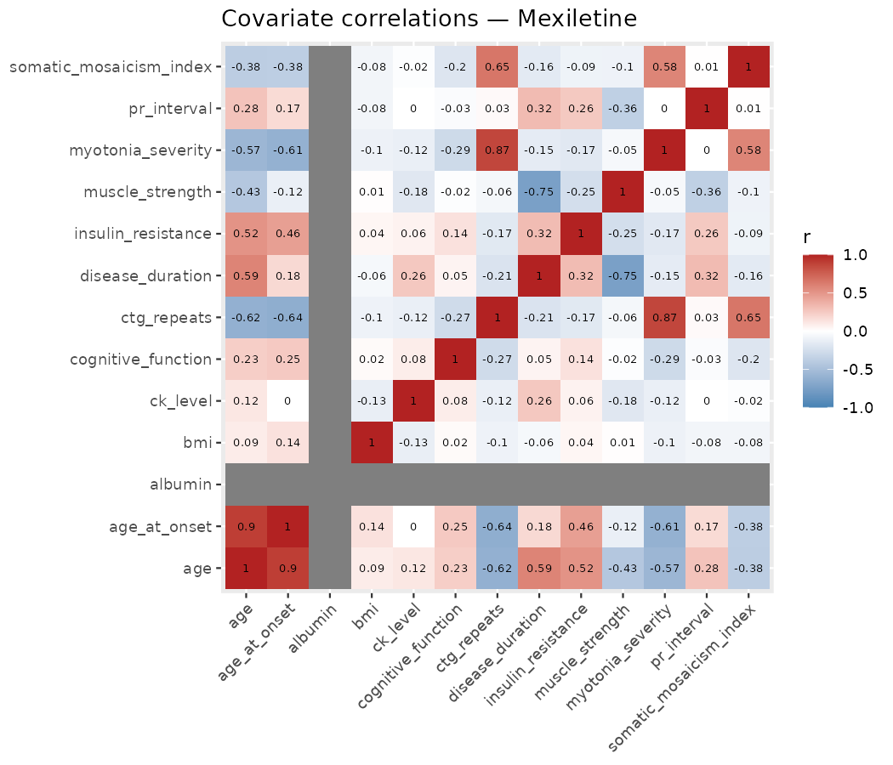
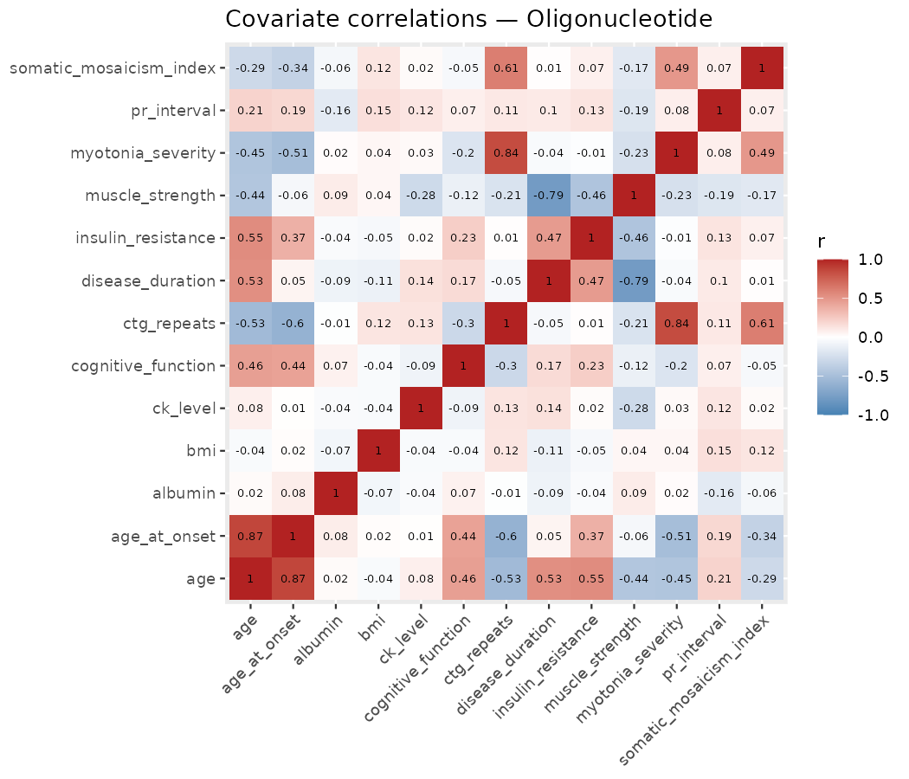
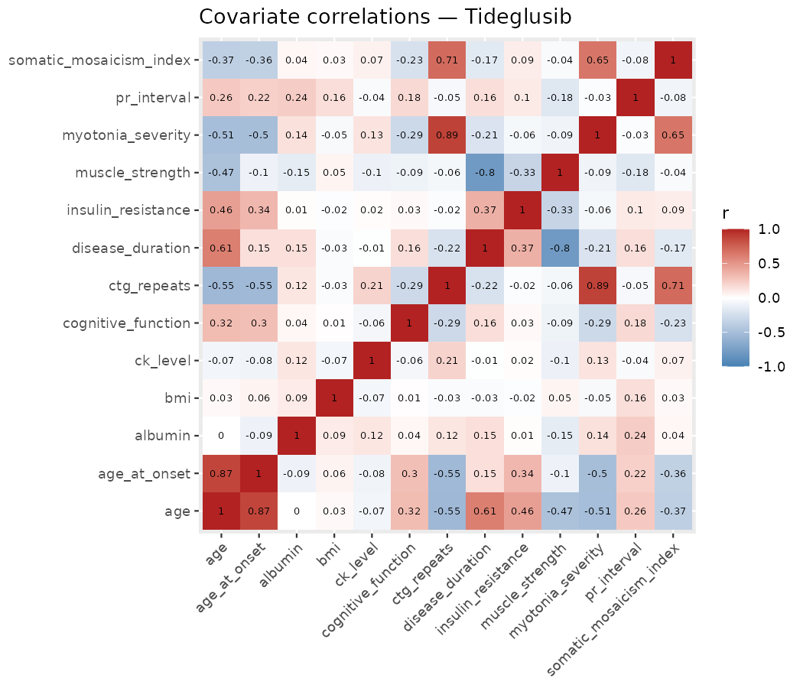

```{r setup, include=FALSE}
knitr::opts_chunk$set(echo = FALSE, message = FALSE, warning = FALSE)
library(knitr)
```

Summary of literature review, exploratory analysis, and a cross-check of three
independent teammate screens (inez, wangui, natiriva), compiled before per-arm
predictive modeling. This document is a **summary of findings already
generated elsewhere** (`inez/eda_by_arm.R`, `wangui/eda.R` /
`covariate_outcome_screen.csv`, `natiriva_code/script_acop.R`) — it does not
introduce new analysis.

## 1. Task context

The hackathon dataset is a simulated 500-patient DM1 clinical trial with
three non-randomly-assigned treatment arms: Mexiletine (n=161),
Oligonucleotide (n=170), and Tideglusib (n=169). Each arm has its own
continuous efficacy outcome and derived binary responder label, populated
only for patients in that arm.

```{r arm-table}
arm_table <- data.frame(
  Arm = c("Mexiletine", "Oligonucleotide", "Tideglusib"),
  N = c(161, 170, 169),
  `Continuous outcome` = c(
    "myotonia_change_12wk (negative = improvement)",
    "qmt_change_26wk (positive = improvement)",
    "tideglusib_composite (0-20, positive = improvement)"
  ),
  `Responder rate` = c("29.2%", "41.2%", "47.9%"),
  check.names = FALSE
)
kable(arm_table)
```

The organizers' data dictionary explicitly states that not every baseline
covariate is a genuine driver of treatment response: some are deliberately
clinically-plausible decoys with no real signal, in a given arm or any arm.
Identifying genuine per-arm drivers while separating them from noise is the
hackathon task itself. The required pipeline splits each arm separately
(stratified by outcome, fixed seed, locked test set) before any modeling;
scoring (30 pts) is split evenly across Clinical, Technical, and
Communication criteria, with correct covariate identification weighted above
model sophistication.

## 2. Literature review

A PubMed search was run for general DM1 severity/response predictors and for
the three specific drug mechanisms represented by the hackathon's treatment
arms.

### General DM1 severity / response predictors

CTG repeat length (progenitor allele) is the most consistently replicated
predictor of DM1 severity (Cumming et al., *Neurology* 2019, OPTIMISTIC
cohort), modified by age and, in some analyses, sex. Patients whose repeat
expands faster somatically (higher somatic mosaicism) develop symptoms
earlier than progenitor length alone predicts — supporting
`somatic_mosaicism_index` as biologically plausible. PR interval / cardiac
conduction is an established DM1 marker, with reported sex differences in
cardiac involvement independent of CTG length (Alen et al., *JACC Adv* 2026,
n=549). Variant repeat interruptions and peripheral blood proteomic markers
have also been associated with clinical outcomes independent of raw repeat
length.

### Mechanism-specific literature by treatment arm

- **Mexiletine** (sodium-channel blocker, treats myotonia symptomatically):
  acts on muscle excitability, so clinical presentation (myotonia severity)
  is expected to matter more than disease-burden markers; a 6-month
  placebo-controlled DM1 trial found myotonia relief did not translate into
  functional gain (6-minute walk distance unchanged).
- **Oligonucleotide** (antisense, targets DMPK mRNA directly): Thornton et
  al. (*Lancet Neurol* 2023) phase 1/2a trial; mechanism frees sequestered
  MBNL proteins and reduces toxic mutant RNA, so both molecular
  (CTG-repeat-linked) and clinical burden may matter. The hackathon dataset
  uses QMT (quantitative muscle testing) rather than the field's more common
  vHOT endpoint.
- **Tideglusib** (GSK3-beta inhibitor): Horrigan et al. (*Pediatr Neurol*
  2020) phase 2 trial in congenital/childhood-onset DM1; GSK3-beta activity
  in blood correlates with muscle weakness (Jennings et al. 2025) and the
  pathway is implicated in CNS/cognitive involvement (Timchenko review 2019)
  — motivating `cognitive_function` and `muscle_strength` as mechanistically
  plausible predictors for this arm specifically. The real-world REACH-CDM
  trial missed its primary endpoint but showed benefit on secondary
  functional measures.

**Implication:** covariates with genuine literature backing as per-arm
response predictors are `ctg_repeats`, `somatic_mosaicism_index`,
`myotonia_severity`, `muscle_strength`, `cognitive_function`, `pr_interval`,
and `age`/`disease_duration`/`sex` as effect modifiers. Covariates such as
`albumin`, `bmi`, `insulin_resistance`, `smoking_status`, `cataracts`, and
`family_history` are real DM1-associated clinical features but were not
found to be mechanistically tied to response to these three drugs — making
them plausible candidates for the dictionary's stated "plausible-looking
decoys."

## 3. Correlation structure and data quirks (inez EDA)

Baseline covariate distributions (medians and full distributions) are
broadly similar across the three arms despite non-random treatment
assignment — no gross imbalance was visually or numerically apparent. Within
every arm, the same recurring correlation structure appears among the
genetic/disease-severity markers: `myotonia_severity` correlates strongly
with `ctg_repeats` (r approximately 0.84–0.89), and `somatic_mosaicism_index`
correlates with both `ctg_repeats` (r approximately 0.61–0.71) and
`myotonia_severity`. Separately, `muscle_strength` correlates strongly and
negatively with `disease_duration` (r approximately −0.75 to −0.80) in all
three arms — longer-standing disease tracks with lower baseline strength —
but is only weakly related to `ctg_repeats` itself (r approximately −0.06 to
−0.21). `age` and `age_at_onset` are near-collinear (r approximately
0.87–0.90), as expected since `disease_duration = age - age_at_onset`
exactly. `albumin`, `bmi`, and `ck_level` are essentially uncorrelated with
everything else in all three arms, consistent with being decoys.

This collinearity matters because the hackathon's suggested covariate-ranking
method (permutation importance) will tend to split credit among correlated
covariates rather than cleanly identifying "the" driver — a caveat worth
stating explicitly in the final presentation.

> **Notable data artifact**: `albumin` is exactly constant (4.18) across all
> 161 Mexiletine patients, but varies normally (range approximately 3.1–5.4)
> in the other two arms. It therefore carries zero predictive variance
> specifically within the Mexiletine arm — independently confirmed by all
> three teammates' analyses.

**Figure 1. Baseline covariate distributions are similar across arms, with
no systematic imbalance from non-random assignment.** Boxplots of nine key
covariates (`ctg_repeats`, `muscle_strength`, `myotonia_severity`,
`somatic_mosaicism_index`, `cognitive_function`, `pr_interval`, `ck_level`,
`age`, `disease_duration`) by treatment arm. Medians and spreads overlap
closely across Mexiletine, Oligonucleotide, and Tideglusib for every
covariate shown, aside from minor differences (e.g., Mexiletine's
`ck_level` runs slightly higher and more dispersed). This supports treating
the three arms as comparable at baseline despite the "weighted by fit"
(non-random) assignment mechanism.

```{r boxplots-fig, fig.cap="Figure 1. Baseline covariate distributions by treatment arm: no systematic imbalance across Mexiletine, Oligonucleotide, and Tideglusib for ctg_repeats, muscle_strength, myotonia_severity, somatic_mosaicism_index, cognitive_function, pr_interval, ck_level, age, or disease_duration (see inez/figures/01_boxplots_by_arm.png).", out.width="90%"}

```

Within-arm correlation structure among the 13 numeric baseline covariates is
shown below for each arm separately. Two correlation groups recur in all
three: (1) `myotonia_severity`, `ctg_repeats`, and `somatic_mosaicism_index`
move together, consistent with all three being markers of the same
underlying genetic disease severity; and (2) `muscle_strength` is strongly,
negatively tied to `disease_duration` specifically (not to `ctg_repeats`),
consistent with progressive strength loss over the course of disease.
`albumin`'s zero-variance row in the Mexiletine heatmap is visible as
blank/NA cells.

**Figure 2. Mexiletine — genetic-severity cluster and the near-trivial
age/age\_at\_onset link dominate the correlation structure.** The strongest
pairwise correlations are `age` with `age_at_onset` (r=0.90, expected since
`disease_duration = age - age_at_onset`), `myotonia_severity` with
`ctg_repeats` (r=0.87), `muscle_strength` with `disease_duration` (r=−0.75),
and `somatic_mosaicism_index` with `ctg_repeats` (r=0.65). `ctg_repeats` is
also moderately negatively correlated with `age` and `age_at_onset`
(r≈−0.62 to −0.64, consistent with genetic anticipation: longer repeats,
earlier/younger onset). `albumin`'s row/column is blank because it has zero
variance in this arm (constant at 4.18 for all 161 patients).

```{r corr-fig-mex, fig.cap="Figure 2. Covariate correlations — Mexiletine. Strongest pairs: age vs. age_at_onset (r=0.90), myotonia_severity vs. ctg_repeats (r=0.87), muscle_strength vs. disease_duration (r=-0.75), somatic_mosaicism_index vs. ctg_repeats (r=0.65); ctg_repeats vs. age/age_at_onset (r~-0.62 to -0.64). Blank row/column for albumin reflects zero variance in this arm.", out.width="80%"}

```

**Figure 3. Oligonucleotide — same genetic-severity cluster, plus a new
insulin\_resistance/age link not seen in the other two arms.** The pattern
mirrors Mexiletine: `age` with `age_at_onset` (r=0.87), `myotonia_severity`
with `ctg_repeats` (r=0.84), `muscle_strength` with `disease_duration`
(r=−0.79), and `somatic_mosaicism_index` with `ctg_repeats` (r=0.61).
`ctg_repeats` is also negatively correlated with `age_at_onset` (r=−0.60).
Notably, `insulin_resistance` correlates with `age` here (r=0.55) — this
pairing does not appear as a top correlation in the other two arms and may
be arm-specific rather than a general feature of the dataset.

```{r corr-fig-oligo, fig.cap="Figure 3. Covariate correlations — Oligonucleotide. Strongest pairs: age vs. age_at_onset (r=0.87), myotonia_severity vs. ctg_repeats (r=0.84), muscle_strength vs. disease_duration (r=-0.79), somatic_mosaicism_index vs. ctg_repeats (r=0.61), ctg_repeats vs. age_at_onset (r=-0.60); insulin_resistance vs. age (r=0.55) is distinctively present only in this arm.", out.width="80%"}

```

**Figure 4. Tideglusib — the genetic-severity cluster is strongest here,
with `somatic_mosaicism_index` also directly tying to `myotonia_severity`.**
`myotonia_severity` with `ctg_repeats` is the single strongest pairwise
correlation across all three arms (r=0.89), alongside `age` with
`age_at_onset` (r=0.87), `muscle_strength` with `disease_duration` (r=−0.80),
and `somatic_mosaicism_index` with `ctg_repeats` (r=0.71).
`somatic_mosaicism_index` is also directly correlated with
`myotonia_severity` (r=0.65) — a pairing not among the strongest in the
other two arms — and `disease_duration` correlates positively with `age`
(r=0.61).

```{r corr-fig-tidge, fig.cap="Figure 4. Covariate correlations — Tideglusib. Strongest pairs: myotonia_severity vs. ctg_repeats (r=0.89, the strongest pair of any arm), age vs. age_at_onset (r=0.87), muscle_strength vs. disease_duration (r=-0.80), somatic_mosaicism_index vs. ctg_repeats (r=0.71), somatic_mosaicism_index vs. myotonia_severity (r=0.65), disease_duration vs. age (r=0.61).", out.width="80%"}

```

## 4. Comparison of three independent EDA/statistical screens

Three team members ran independent exploratory analyses. The table below
summarizes each approach's scope and outcome definition.

```{r method-table}
method_table <- data.frame(
  Teammate = c("inez", "wangui", "natiriva"),
  `Covariate structure` = c(
    "Within-arm correlation matrices; boxplots by arm", "-", "-"
  ),
  `Continuous covariate test` = c(
    "-",
    "Spearman rho vs. continuous outcome (unadjusted)",
    "Spearman rho vs. continuous outcome + Mann-Whitney U vs. responder (both FDR-corrected)"
  ),
  `Categorical covariate test` = c(
    "-",
    "Kruskal-Wallis vs. continuous outcome (unadjusted)",
    "Fisher's exact vs. responder (FDR-corrected)"
  ),
  `Train/test split used` = c(
    "n/a",
    "seed 1234, data/derived/split/ (shared)",
    "seed 5182, own locked_test_sets/ (separate)"
  ),
  check.names = FALSE
)
kable(method_table)
```

> **Open issue:** wangui and natiriva each created their own arm-stratified
> train/test split with different seeds, stored in different locations. The
> rubric requires locking **one** split per arm before modeling, so this
> needs to be resolved to a single shared split before any model results are
> compared on a team scoreboard.

### 4.1 Side-by-side significance comparison

★ = significant unadjusted (p<0.05); ✦ = still significant after FDR
correction (natiriva). Spearman rho shown where available (wangui's and
natiriva's continuous-outcome tests are numerically identical; natiriva adds
FDR correction).

```{r sig-table}
sig_table <- data.frame(
  Covariate = c(
    "myotonia_severity", "ctg_repeats", "somatic_mosaicism_index",
    "age / age_at_onset", "cognitive_function", "muscle_strength",
    "disease_duration", "insulin_resistance", "phenotype (categorical)",
    "sex / cataracts / family_history",
    "bmi, ck_level, pr_interval, smoking_status, albumin"
  ),
  Mexiletine = c(
    "★✦ (rho=-0.84)", "★✦ (rho=-0.73)", "★✦ (rho=-0.44)",
    "★✦ (rho~0.49-0.50)", "★✦ (rho=0.23)", "ns",
    "★ unadj., ✦ after FDR", "★ unadj., ns after FDR",
    "★✦ (both tests)",
    "sig. on KW-vs-continuous, not on Fisher-vs-responder",
    "ns everywhere (albumin also structurally constant)"
  ),
  Oligonucleotide = c(
    "★✦ (rho=0.38)", "★✦ (rho=0.44)", "★✦ (rho=0.30)",
    "★ unadj. only, lost after FDR", "ns", "★✦ (only sig. arm, rho=-0.23)",
    "★✦", "★ unadj., ns after FDR", "★✦ (both tests)",
    "mostly ns", "ns everywhere"
  ),
  Tideglusib = c(
    "★✦ (rho=0.29)", "★✦ (rho=0.29)", "★✦ (rho=0.22)",
    "★✦ (rho~ -0.20 to -0.28)", "★✦ (rho=-0.63, strongest)", "ns",
    "★ unadj., ns after FDR; also collinear with age/age_at_onset", "ns",
    "★ (KW), borderline/ns after FDR (Fisher)", "mostly ns",
    "ns everywhere (pr_interval borderline, p=0.06-0.10)"
  ),
  check.names = FALSE
)
kable(sig_table)
```

A methodological note: `sex`, `cataracts`, and `family_history` appear
significant only when tested against the continuous outcome (wangui's
Kruskal-Wallis), not against the binary responder label (natiriva's Fisher's
exact test). This outcome-definition sensitivity suggests these are weak,
borderline effects that should not be leaned on as confident findings.

`disease_duration` is an exact linear function of `age` minus
`age_at_onset`. natiriva's multivariate linear models correctly drop it to
avoid aliasing/VIF issues; the team should standardize on dropping it (or one
of the three age-related covariates) consistently across all models.

## 5. Synthesized candidate covariate list per arm

Where literature, within-arm correlation structure, and both teammates'
independent statistical tests agree:

```{r candidate-table}
candidate_table <- data.frame(
  Arm = c("Mexiletine", "Oligonucleotide", "Tideglusib"),
  `Candidate real predictors` = c(
    "myotonia_severity (dominant), ctg_repeats, age/age_at_onset, somatic_mosaicism_index, phenotype — collinear with each other, mechanistically consistent with a muscle-excitability drug",
    "ctg_repeats, myotonia_severity, somatic_mosaicism_index, muscle_strength (its only significant arm, matches QMT-based mechanism), disease_duration, phenotype",
    "cognitive_function (dominant, matches GSK3-beta/CNS mechanism), ctg_repeats, myotonia_severity, age/age_at_onset, somatic_mosaicism_index; phenotype weaker here than other arms"
  ),
  check.names = FALSE
)
kable(candidate_table)
```

- **Consistent decoys** across all three arms, all three analyses, and the
  literature: `bmi`, `ck_level`, `pr_interval`, `smoking_status`, `albumin`
  (plus its Mexiletine-specific zero-variance artifact).
- **Uncertain / outcome-definition-sensitive**: `sex`, `cataracts`,
  `family_history`, `insulin_resistance`.

## 6. Open items before finalizing per-arm models

1. Resolve the dual train/test split (wangui's shared split vs. natiriva's
   separate locked split) to a single, agreed, locked split per arm.
2. Standardize handling of `disease_duration` (exact linear combination of
   `age` and `age_at_onset`) across all models to avoid aliasing/VIF
   inflation.
3. Because of the `ctg_repeats` / `myotonia_severity` / `muscle_strength` /
   `somatic_mosaicism_index` correlation cluster, permutation importance
   will likely split credit; consider reporting results at the cluster
   level, or using a method (elastic net) that handles correlated
   predictors explicitly, and discuss this collinearity directly in the
   presentation.
4. Review natiriva's elastic net and multivariate linear model (with VIF
   diagnostics) results once the split is finalized, to see which covariate
   from each correlated cluster survives multivariate selection.
