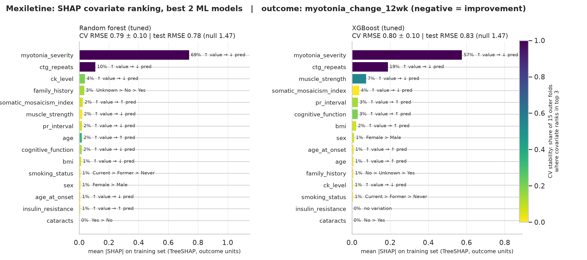
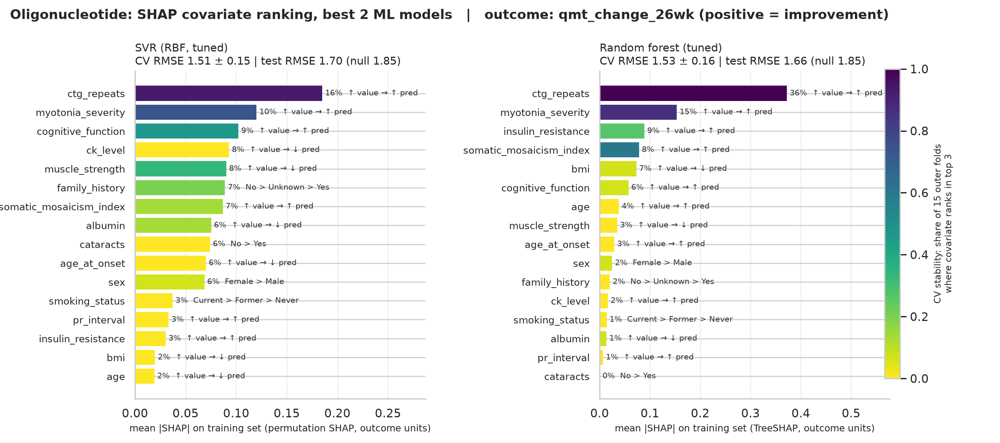
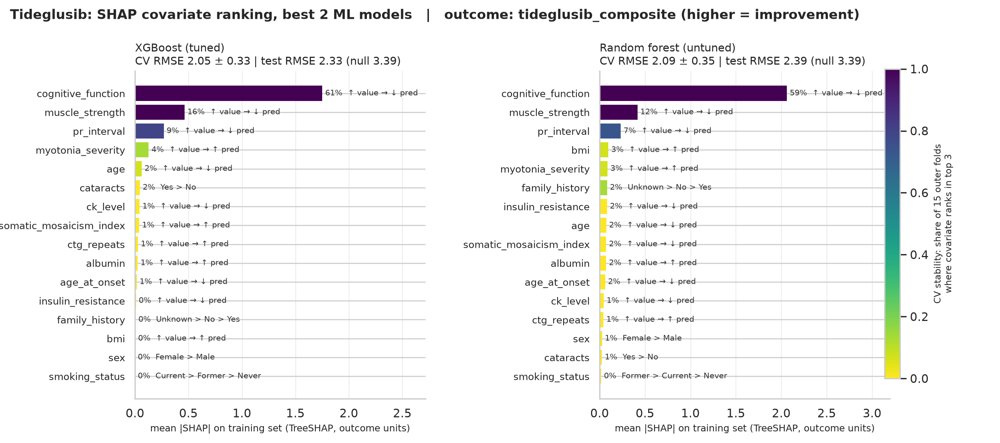

<!--
Figures are produced by make_shap_figures.py (run it first):
  %run sharvari/shap_slides/make_shap_figures.py
then render from the repo root:
  quarto render sharvari/shap_slides/shap_rankings.qmd
-->

## How the two models per arm were chosen

| Arm | Model 1 | CV RMSE | Model 2 | CV RMSE | Null test RMSE |
|---|---|---|---|---|---|
| Mexiletine | RF (tuned) | 0.79 ± 0.10 | XGBoost (tuned) | 0.80 ± 0.10 | 1.47 |
| Oligonucleotide | SVR (tuned) | 1.51 ± 0.15 | RF (tuned) | 1.53 ± 0.16 | 1.85 |
| Tideglusib | XGBoost (tuned) | 2.05 ± 0.33 | RF (untuned) | 2.09 ± 0.35 | 3.39 |

::: notes
CV RMSE is mean ± SD over the 15 outer folds. The two models within each arm are within one SD of each other, so neither one is the clear winner.
:::

## Selection rule and how to read the plots

- Best variant from each ML family (RF, XGBoost, SVR), ranked by outer CV RMSE on training data. The test set was not used for selection.
- Full 16-covariate set (15 for Mexiletine). SHAP computed on the training set.
- Bar length is mean |SHAP|. Colour is the share of 15 CV folds where the covariate ranked in the top 3, i.e. its stability.
- Bar labels show the covariate's share of total |SHAP| and its direction (↑ value → ↑/↓ prediction; for categoricals, levels ordered by mean SHAP).
- RF and XGBoost use TreeSHAP. SVR uses model-agnostic permutation SHAP. Both are in outcome units.

## Mexiletine: myotonia_severity dominates, ctg_repeats is a stable #2

::: notes
In both models, myotonia_severity carries 57-69% of total |SHAP| and ranks in the top 3 in every CV fold. Higher baseline severity gives a lower (more negative, i.e. better) predicted myotonia change, which fits a symptomatic Na+ channel blocker. ctg_repeats is also top 3 in every fold for both models. Below rank 3, the order changes between models and folds, so treat it as noise.
:::

## Oligonucleotide: ctg_repeats leads in both models, but the signal is weak

::: notes
ctg_repeats ranks #1 for both SVR and RF, and higher repeat count predicts a larger QMT gain. That fits an ASO that targets the toxic DMPK RNA. myotonia_severity is a consistent #2. Overall predictive power is low (test R2 about 0.14-0.19, and the test RMSE intervals overlap the null), and importance in the SVR is spread out. Beyond the top 2, the ranking is not reliable.
:::

## Tideglusib: cognitive_function, muscle_strength and pr_interval agree across models

::: notes
XGBoost and RF give the same top 3 in the same order. cognitive_function carries about 60% of |SHAP| and is top 3 in every fold. muscle_strength is also top 3 in every fold, and pr_interval in 73-80% of folds. All three point the same way: higher baseline value, lower predicted composite score.
:::

## Signal vs noise across arms

| Arm | Agreed top covariates (both models, top 3 in ≥ 70% of CV folds) | Test R² (model 1 / model 2) |
|---|---|---|
| Mexiletine | myotonia_severity, ctg_repeats | 0.72 / 0.68 |
| Oligonucleotide | ctg_repeats, myotonia_severity | 0.14 / 0.19 |
| Tideglusib | cognitive_function, muscle_strength, pr_interval | 0.53 / 0.50 |

## Interpretation and caveats

- The top covariate in each arm matches the drug's mechanism: symptom severity for Mexiletine, repeat burden for the ASO, cognition plus motor for Tideglusib.
- Covariates outside this list are unstable across folds and models, so we treat them as noise.
- SHAP explains what the model uses, not causal effects. Each test set has only 20-35 patients, so small differences between models are not meaningful.
